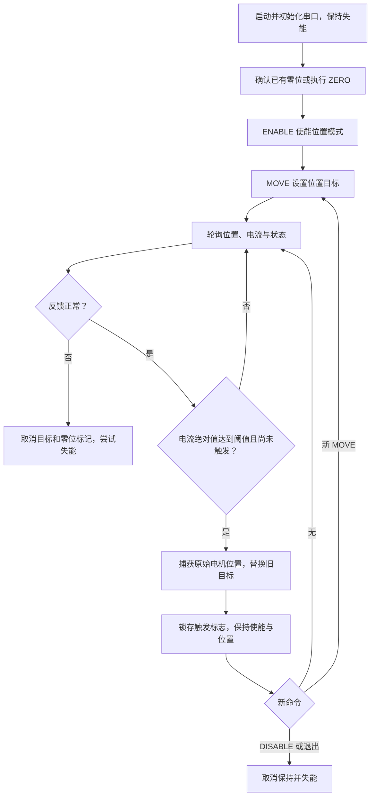

# RS485 夹爪控制工程说明

更新日期：2026-10-09。当前工程通过 USB 转 RS485 控制现场 ID 1 夹爪，采用位置闭环，并在反馈电流绝对值达到 **0.5 A** 后取消原目标、保持触发时的位置。

## 工程与运行环境

| 项目 | 当前配置 |
|---|---|
| 本地工程 | `D:\Works\Projects\ws.qt5\gripper_RS485_so` |
| 远程主机 | `cobot@192.168.6.16` |
| 远程工程 | `/home/cobot/Works/gripper_RS485_so` |
| 运行平台 | Linux x86_64，C++17 |
| 串口 | `/dev/ttyUSB0`，CH340 USB 转 RS485 |
| Modbus 从站 ID | `1`，已完成通信与实机测试 |
| 波特率 | `115200` |
| 开度范围 | `0～0.098 m`，即 `0～98 mm` |
| 默认电流阈值 | `0.5 A`，检查反馈电流绝对值 |

本地用于编辑和保存源码；现有 `.so` 与串口实现面向 Linux，Windows 下不能直接运行此夹爪程序。远程曾临时停止 `brltty`，并按要求将串口权限设为 `777`；重插或重启后应检查设备节点、权限及串口是否被占用。

## 文件结构

| 路径 | 用途 |
|---|---|
| `demo/main.cpp` | 命令行解析、JSON 输出、反馈轮询调度 |
| `demo/messages.hpp` | 与 ROS 无关的控制与反馈数据结构 |
| `demo/controller.hpp/.cpp` | 零位确认、使能、移动、电流触发保持、异常处理 |
| `demo/hardware.cpp` | SDK 与 RS485 硬件适配，原始位置保持 |
| `demo/calibration.hpp`、`demo/calibration.csv` | 原始电机角度与物理开度的双向映射 |
| `demo/run.sh` | 启动入口，将 JSON 与供应商库日志分开 |
| `demo/tests.cpp`、`demo/calibration_test.cpp` | 假硬件状态机测试、标定表测试 |
| `demo/inspect_position.cpp` | 现场位置诊断工具 |
| `include/`、`lib/x86/` | 供应商头文件与 Linux SDK 库 |
| `src/` | 供应商原始示例 |
| `docs/API接口使用手册v1.0.6.pdf` | 供应商 API 手册 |
| `demo/README.md` | 详细实现、标定记录和 ROS2 接口草案 |

## 编译与启动

在远程 Linux 主机执行：

```sh
cd /home/cobot/Works/gripper_RS485_so
cmake -S demo -B demo/build -DCMAKE_BUILD_TYPE=Release
cmake --build demo/build -j2
ctest --test-dir demo/build --output-on-failure
./demo/run.sh --help
```

依赖为 `g++`、`cmake`、`libeigen3-dev`。启动时，如果已确认当前零位有效：

```sh
./demo/run.sh --use-existing-zero --current-threshold-a 0.5 /dev/ttyUSB0 1 115200
```

`0.5 A` 已是默认值，可省略阈值参数。程序启动后不自动标零、使能或运动。必须保持标准输入打开；输入关闭、`QUIT`、SIGINT 或 SIGTERM 会尝试失能并退出。同一串口只运行一个控制进程。

## 控制协议与输入方式

外部程序通过标准输入逐行发送文本命令，每条以换行结束。人在启动程序的终端中输入相同命令。反馈与 ACK 从标准输出读取，日志从标准错误读取。

| 命令 | 含义 |
|---|---|
| `ENABLE 1` | 使能位置模式，要求零位已确认有效 |
| `MOVE 2 0.000 0.010` | 以给定速度请求闭合到 0 mm，受电流触发保持保护 |
| `MOVE 3 0.098 0.010` | 请求张开到 98 mm |
| `DISABLE 4` | 取消目标并失能，撤销保持力 |
| `CLEAR 5` | 清除驱动错误并检查状态 |
| `ZERO 6` | 主动张开执行标零；完成后失能 |
| `QUIT` | 失能并退出，无命令编号 |

`MOVE 编号 开度(m) 速度(m/s)` 中速度必须有限且大于 0；推荐测试速度 `0.010 m/s`。命令编号用于关联 ACK 与反馈，**不是夹爪的 Modbus ID**。编号不去重、不排序，新接受的 MOVE 替换旧目标。

每次先检查 ACK：

```json
{"type":"ack","command_id":2,"accepted":true,"detail":"accepted"}
```

ACK 表示命令已接受或操作完成，MOVE 的 ACK 不表示运动已到位。需要持续读取反馈判断位置、故障或电流触发状态。自动客户端应保持一个进程和双向管道，并按 ACK/反馈推进流程；不要一次性管道发送全部动作后立即关闭输入。

## 控制流程与电流保护



正、负电流均参与阈值判断，因此张开与闭合都受此逻辑影响。触发后只捕获一次位置；电流回落不会恢复原目标，也不会让保持目标跟随反馈漂移。新 MOVE 重置触发标志；DISABLE、ZERO 或故障取消本次保持。

保持使用 POS 模式下的原始电机角度，没有切换成力矩模式。它允许在接触后停止追求原始闭合位置，但仍可产生保持力。反馈轮询与串口下发存在延迟，触发帧可能超过 0.5 A；该功能不是驱动器硬件限流或恒力控制。轮询目标周期为 100 ms，实际周期受 SDK 调用耗时影响。

## 反馈协议

通过 `run.sh` 输出 JSON Lines，每行一条 ACK 或反馈。以下为本次硬物测试的触发帧：

```json
{"type":"feedback","stamp_ns":1791519816648825642,"command_id":2,"valid":true,"position_m":0.0352403534,"motor_position_rad":40.2754326,"motor_current_a":0.560000002,"motor_torque_percent":16.8571415,"force_n":19.9975857,"error_code":0,"enabled":true,"homed":true,"at_target":false,"current_threshold_a":0.5,"current_limit_reached":true,"holding_position":true,"target_active":true,"target_position_m":0.0352403534}
```

| 字段 | 含义 |
|---|---|
| `stamp_ns` | 读取结束时的 Unix 纳秒时间戳 |
| `command_id` | 最后接受的命令编号；触发保持后仍关联原 MOVE |
| `valid` | 本次反馈是否有效 |
| `position_m` | 标定模型换算的夹爪开度，m |
| `motor_position_rad` | SDK 原始电机位置，rad |
| `motor_current_a` | SDK 直接读取的电流，A，带符号 |
| `motor_torque_percent` | 额定力矩/电流百分比，不是 N·m |
| `force_n` | 机构模型估算力，N，不是力传感器实测 |
| `error_code` | 驱动器错误位图；0 表示无已报告错误 |
| `enabled`、`homed` | 驱动器使能、当前进程零位确认状态 |
| `at_target` | 未触发保持且满足位置到位条件；触发后为 false |
| `current_threshold_a` | 本次运行阈值，默认 0.5 A |
| `current_limit_reached` | 电流触发锁存标志 |
| `holding_position` | 已触发且仍使能保持捕获位置 |
| `target_active` | 是否存在有效位置目标 |
| `target_position_m` | 生效目标；触发后改为捕获开度，无目标时为 null |

`valid=false` 时测量值、错误码和使能状态输出 null；消费者应忽略这些字段。反馈字段由 SDK 顺序读取，不是一帧同步采样。串口或驱动故障时程序尝试失能，但断线时不能保证设备收到指令。

## 标零与行程修正

无需每次启动程序都标零；已有零位确认有效时使用 `--use-existing-zero`。SDK 没有零位有效性查询接口，重新上电后是否保留零位需要现场确认。

当前夹爪由用户手动张开到最大机械端，实测两指间距 **98 mm**，在此位置设为电机零点。闭合端角度由旧零位下手动开、闭两端读数的差值推算，为 **61.2092854977 rad**；新零位下的闭合端独立实测复核仍有待完成。

`demo/calibration.csv` 有 513 个点，基于机构模型非线性形状和两端归一化生成，并非逐点实测。表只适用于现场 ID 1 夹爪。更换夹爪、改变零点、机构或软垫后应重新校准。指令范围为 0～98 mm；反馈端点容差为 0.2 mm，小幅外推值保留，超过容差则按异常处理。

`ZERO` 会主动张开，使用 -17% 输出、最多等待 10 s，并检查停止位置是否接近已校准的张开端。期间阻塞命令处理与反馈；不能在夹有硬物时执行。零位已经丢失时，应先现场确认端点再重新校准，不能反复发送 ZERO 来猜测零点。

## 已完成验证

| 测试 | 结果 |
|---|---|
| 远程编译与 CTest | 编译成功；状态机与标定测试共 2 项通过 |
| 修正后全行程开合 3 轮 | 错误码均为 0；模型反馈达到目标附近 |
| 追加空载开合 3 轮 | 采样电流绝对值峰值约 0.19～0.22 A |
| 临时 0.05 A 触发测试 | 成功取消旧目标并锁存保持位置；仅用于验证逻辑 |
| 0.5 A 硬物接触测试 | 请求闭合至 0 mm，在约 35.240 mm、0.56 A 时触发 |
| 硬物保持观察约 3 s | 位置约 35.241 mm，电流约 0.08 A，目标不变、错误码 0 |

硬物测试结束后已失能并退出；失能首帧开度约 35.384 mm、电流约 0.02 A。记录保存在本地 `tmp/object_hold_test.jsonl` 和 `tmp/object_hold_test_stderr.log`。以上验证不代表全行程物理精度、真实夹持力或其他物体的测试结果。

## ROS2 迁移建议

复用 `Controller`、`Hardware` 和纯数据结构，用 ROS2 订阅回调替换标准输入，用发布器替换 JSON 输出。控制消息仅需 `command_id`、`action`、`position_m`、`speed_mps`；原始电机位置和电流属于反馈消息。完整消息草案见 `demo/README.md`。

建议话题为 `/gripper_1/command` 与 `/gripper_1/state`，串口、设备 ID、波特率和电流阈值作为节点参数。所有 SDK 调用由一个工作线程串行执行；订阅回调入队，避免并发访问非线程安全的 Controller。ZERO 可改为 action/service。ROS 消息不支持 null，消费者应依据 `valid`、`target_active` 判断字段是否可用。

## 本次同步记录

已从远程下载比对工程源码、标定表、SDK 库及手册，共 **28 个文件**，逐文件 SHA-256 校验一致；下载前本地已与远程相同。本次新增、更新说明文档后另行同步到远程。

构建产物、临时记录、Git 元数据与运行环境缓存不纳入代码同步；本地额外文件未删除。原始同步清单见 `tmp/remote_sync_manifest.json`。没有修改运动控制代码，软件验证结果沿用最近一次默认阈值 0.5 A 的远程编译和 CTest。
